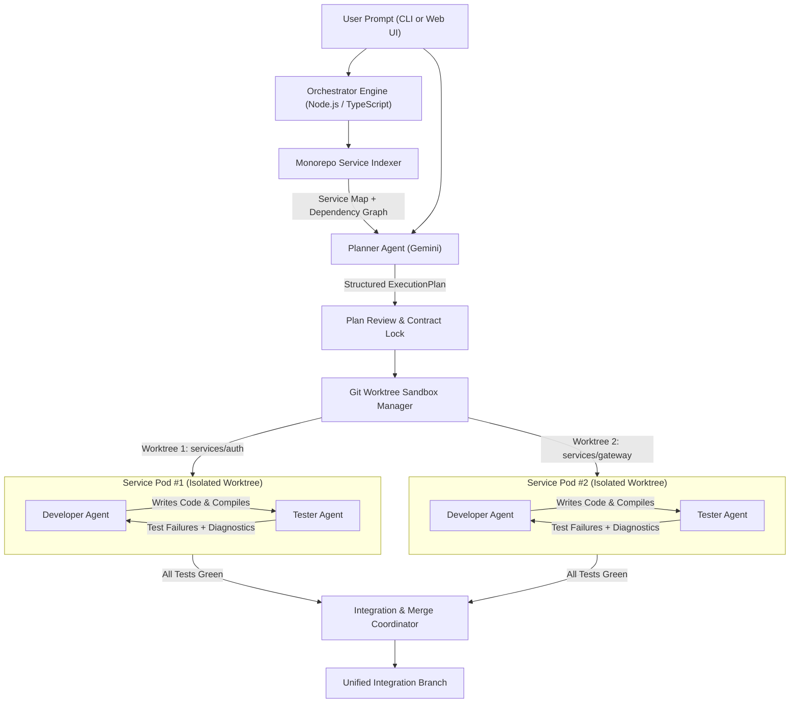

# Agentic Multi-Service Software Developer App

An autonomous software engineering orchestrator built in **Node.js and TypeScript** using the official `@google/genai` SDK and **Gemini**. Given a natural-language feature or bugfix prompt, the system indexes a monorepo, generates a structured multi-service architectural plan, provisions isolated **Git worktrees** per affected service, and dynamically spawns **Developer + Tester agent pods** that iterate in parallel until all service tests pass.

---

## Key Features

- **Monorepo Service Indexer**: Automatically scans and inspects monorepos (`services/*`, `packages/*`, `apps/*`), parses dependencies, scripts, entrypoints, and test suites.
- **Contract-First Architectural Planning**: Gemini-powered `PlannerAgent` designs cross-service shared contracts (TypeScript interfaces / REST schemas) and structures wave-based execution plans.
- **Git Worktree Sandbox Manager**: Provisions isolated Git worktrees and branches per service (`agent-run/<runId>/<serviceId>`), completely eliminating filesystem conflicts during parallel execution.
- **Developer + Tester Pod Lifecycle**:
  - **Developer Agent**: Implements code, complies with shared contracts, runs build/typecheck, and fixes defects.
  - **Tester Agent**: Restricted to test files (`*.test.ts`, `*.spec.ts`, `test/**`) by strict separation of duties; authors tests, runs test runners, and submits structured verdicts.
  - **Iterative Feedback Loop**: Agents iterate up to $N$ times until all acceptance criteria are met and all tests pass green.
- **Integration & Merge Coordinator**: Conflict-free branch merging into a unified integration branch (`agent-run/<runId>/integration`).
- **Interactive CLI & Real-Time Web Dashboard**:
  - `agentic-dev run "<prompt>"`: Rich terminal execution with colorized spinners and real-time logs.
  - `agentic-dev serve`: Fastify server hosting REST APIs, WebSocket event stream, and a Vite + React + Tailwind real-time dashboard.

---

## Architecture Flow



---

## Getting Started

### 1. Installation

```bash
# Install backend dependencies
npm install

# Install web dashboard dependencies
npm --prefix web install
```

### 2. Configuration

Copy `.env.example` to `.env` and provide your Google Gemini API key:

```bash
cp .env.example .env
```

```env
GEMINI_API_KEY=your_gemini_api_key_here
GEMINI_PLANNER_MODEL=gemini-2.5-pro
GEMINI_DEV_MODEL=gemini-2.5-pro
GEMINI_TESTER_MODEL=gemini-2.5-flash
MAX_POD_ITERATIONS=4
PORT=4200
```

*(Note: If no API key is provided or `SIMULATE_LLM=true` is set, the system automatically runs in deterministic simulation mode for local dry-runs and automated test suites).*

### 3. Build

```bash
# Build both TypeScript backend and React frontend
npm run build:all
```

---

## Usage

### Run via CLI

Run an autonomous multi-service task against any monorepo:

```bash
# Run against the included demo monorepo
npm start -- run "Add token expiration check and update gateway" --repo examples/demo-monorepo

# Or inspect repository topology
npm start -- index --repo examples/demo-monorepo
```

### Run the Web Dashboard & Server

Start the real-time server and open the web dashboard:

```bash
npm run serve
```

Visit **http://127.0.0.1:4200** in your browser to:
- Enter multi-service feature requests or bugfix prompts.
- Inspect the generated architectural plan, shared contracts, and wave DAG.
- Watch live parallel swimlanes for each spawned Developer + Tester service pod.
- View real-time colorized terminal streams of tool calls, diffs, and test runner outputs.

---

## Running Tests

Run the full Vitest test suite covering indexer, worktree sandboxing, path-jailing security, and end-to-end orchestrator workflows:

```bash
npm test
```
